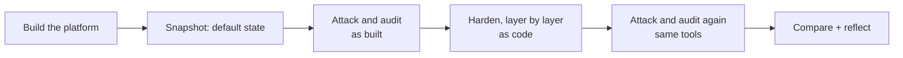

# server-security-lab

[](https://github.com/LibreOpsLab/server-security-lab/actions/workflows/ci.yml)
[](LICENSE)

A hands-on build repo for teaching **server and infrastructure security**, designed for classrooms, but
usable for self-study. Learners take a private copy of it, build a small business platform week by week, then do what
real engineers do: **attack it, harden it, attack it again, and explain the difference.**

> **Status: early, unverified.** The whole lab build (docs, scripts, automation) is written and tested
> statically; none of it has been run end to end on a real workstation yet. See
> [docs/build/STATUS.md](docs/build/STATUS.md) for what is verified and what is not, and
> [docs/instructor-weak-defaults.md](docs/instructor-weak-defaults.md) for the security tooling's status.
> Help validating any of it is the most useful contribution right now (see [CONTRIBUTING.md](CONTRIBUTING.md)).

## Why this exists

Most courses teach learners to build one server at a time. Security only really makes sense when the whole
platform exists: network, hosts, services and identity, each a layer an attacker has to get through (an
onion has layers, and so should your defences). This repo makes that loop concrete and measurable:



Learners produce their own timestamped **before and after reports**, generated by the same tools both
times, so the comparison is real. What is assessed is _what changed and what they understood about it_,
not a score. A short reflection asks why hardening matters, and why many people resent it for the
maintenance and support burden it adds.

## What you get

| Piece            | What it does                                                                                                                                                       |
| ---------------- | ------------------------------------------------------------------------------------------------------------------------------------------------------------------ |
| `weeks/`         | Week guides with starter files (TODOs for the learner to complete) and a `check.sh` per week                                                                       |
| `scaffold/sslab` | A small stdlib-only Python tool: audit, attack, compare. Writes Markdown + HTML reports                                                                            |
| Fixed attack set | Five short, well-known attacks (service enumeration, weak SSH credentials, web headers, mail relay, anonymous shares), in [docs/attack-set.md](docs/attack-set.md) |
| Scope guard      | Tools refuse to touch anything outside the lab ranges the learner wrote down first                                                                                 |
| `portfolio/`     | Where the learner's generated evidence and reflection live (they own this folder)                                                                                  |
| `docs/`          | Git workflow, the attack set, how it works, instructor notes                                                                                                       |

Everything is open source and lightweight: Lynis, nmap, hydra, curl and smbclient for the tooling;
Python 3.11+ standard library only; no database, no services to run.

## Getting Started

New to Git, GitHub, VS Code or Python? Start with **[DevOps 101: set up your development
environment](docs/devops-101.md)**. You can read and follow the guide right here in your browser before
installing anything. It walks you through:

1. Installing Git, VS Code and Python with `winget`.
2. Setting your Git identity and cloning your instructor-provided private repository into `%USERPROFILE%\dev`.
3. Navigating code and documentation in VS Code, previewing Markdown, and using the Source Control view to
   commit, pull and push.
4. Connecting VS Code to GitHub and syncing your branch.

After setup, read [Git workflow for the lab](docs/git-workflow.md) to learn the weekly branches, pull
requests and upstream updates. Then start building with the [welcome guide](docs/build/00-welcome.md).
Students should use their private course repository for lab work, not push it to the public upstream repo.

## Build the whole lab

This repo is two things: the full infrastructure build (docs, Ansible, scripts — start at
[docs/build/00-welcome.md](docs/build/00-welcome.md)) and the security tooling below that measures it. Build
the lab first; the security loop needs a working platform to test.

See also: [design](docs/design/lab-build-design.md) and [how it works](docs/how-it-works.md).

## Quick start

```bash
# 1. Make your own PRIVATE copy (needs git and the GitHub CLI, logged in with `gh auth login`)
curl -fsSLO https://raw.githubusercontent.com/LibreOpsLab/server-security-lab/main/scripts/create-private-copy.sh
bash create-private-copy.sh && cd server-security-lab

# 2. Check the tooling works
cd scaffold && python -m pytest && cd ..

# 3. Follow the week guides in weeks/, then, in the baseline week:
cp weeks/12-baseline-attack/scope.txt.example portfolio/scope.txt   # edit: your lab ranges only
weeks/12-baseline-attack/check.sh <host> [<host> ...]
```

Reports land in `portfolio/reports/`. Commit them without editing them.

> **Why a private copy, not a GitHub fork?** A fork of a public repo is always public, and your build
> will contain details of your lab. The script makes a private repo with the same history and adds this
> repo as `upstream`, so `git fetch upstream` and `git merge upstream/main` work just like a fork. The
> manual steps are in [docs/git-workflow.md](docs/git-workflow.md).

## Repository layout

| Folder       | Owner    | Purpose                                                  |
| ------------ | -------- | -------------------------------------------------------- |
| `docs/`      | upstream | Git workflow, attack set, how it works, instructor notes |
| `scaffold/`  | upstream | The `sslab` tool and its tests                           |
| `weeks/`     | upstream | Steps, starter files and checks for each week            |
| `build/`     | learner  | Their finished work: inventory, playbooks, configs       |
| `portfolio/` | learner  | Their evidence: reports, scope, reflection               |

**Ownership rule:** upstream owns `docs/`, `scaffold/` and `weeks/`; learners own `build/` and
`portfolio/`. Pulling upstream changes then rarely conflicts, and the one place it can (editing a
scaffold file) is a deliberate lesson in merge conflicts. See [docs/git-workflow.md](docs/git-workflow.md).

## The lab it is designed around

A typical reference setup, which you can adapt:

- Shared workstations (about 10 cores, 32 GB RAM, 512 GB+ NVMe) running VMware Workstation, with two NICs
  (one for the lab, one for the internet).
- A firewall VM (pfSense), an admin VM (Ubuntu Desktop with Ansible and git; the attack tools run here),
  a Windows client and server, and nested Proxmox VE hosting the Linux services.
- Optional stretch: pair up and attack each other's labs from a Kali machine, with both partners'
  consent and the same scope rules.

## Responsible use

This repo contains attack tooling. **Use it only against systems you own or have written permission to test.**
The tools check a scope file the learner writes first and refuse other targets, but that is a teaching aid,
not a security control. Please read [SECURITY.md](SECURITY.md).

## Documentation

- [DevOps 101: set up your development environment](docs/devops-101.md): install Git, VS Code and Python on Windows, clone your course repository and learn the basic Git commands
- [How it works](docs/how-it-works.md): architecture and the reasons behind the design
- [Attack set](docs/attack-set.md) · [Git workflow](docs/git-workflow.md)
- [Instructor notes: weak defaults and lab validation](docs/instructor-weak-defaults.md)
- [Contributing](CONTRIBUTING.md) · [Changelog](CHANGELOG.md) · [Code of Conduct](CODE_OF_CONDUCT.md)

## Using this in your own course

You are welcome to fork and adapt it for your own teaching (MIT licence). Week numbers, host names and
the attack set are all plain files you can change. If you improve something that others would benefit
from, a pull request is appreciated.

## Licence

[MIT](LICENSE). The licence covers the code, documentation and templates in this repo. Third-party tools it
drives (Lynis, nmap, hydra and others) have their own licences.
