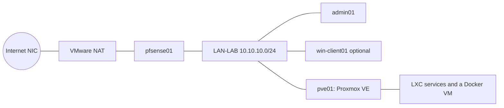

# Welcome

Welcome, now let's build the LAB infrastructure we are going to need to complete this class. By the end of
guide 18 you will have a small business's IT estate running on your own workstation: a firewall, central
identity with single sign-on, file and mail services, applications, monitoring, backup, and wireless
authentication. You build it yourself, from code, so it is repeatable: a wiped PC costs an afternoon to
rebuild, not a term.

> **What's going on:** Weeks 1 to 11 are the _build_. Weeks 12 to 20 are the _security work_: attack what
> you built, harden it, attack it again and explain the difference. You cannot do the second half without a
> working first half, which is why the build has spare weeks in it. Read [WEEK-MAP.md](WEEK-MAP.md) to see
> where each guide falls.

## Before you start

You do not need to know Linux, networking or Ansible yet. You do need:

- The [DevOps 101](../devops-101.md) setup finished: Git, VS Code and Python installed on the Windows
  workstation, and your private course repository cloned.
- (Studying on your own? Read [How to prepare for the lab](../instructor/prepare-the-lab.md#studying-on-your-own)
  first: it lists what to download and where from.)
- A lab workstation (reference spec: about 10 cores, 32 GB RAM, 512 GB or more of fast storage, two network
  adapters) with VMware Workstation installed, and the ISO files your lecturer lists: pfSense, Proxmox VE 9,
  Debian 13 (netinst) and Ubuntu Desktop 26.04 LTS.
- A USB drive or other place outside the PC for backing up your secrets (guide 05).
- Patience. You will get stuck. That is normal, and the evidence rules below make sure being stuck still
  earns credit.

## What you will build

| Layer        | Guides   | What it gives a small business                                      |
| ------------ | -------- | ------------------------------------------------------------------- |
| Foundations  | 01 to 06 | A private network, a firewall, a hypervisor and a control machine   |
| Identity     | 07, 08   | One list of staff accounts, names and clocks everything else trusts |
| Applications | 09 to 14 | Web proxy, sign-in portal, apps, email, file shares, Wi-Fi sign-in  |
| Operations   | 15, 16   | Monitoring and logs, backups you have proved you can restore        |
| Proof        | 17, 18   | An optional Windows PC, and a test that checks every service        |

See [docs/design/lab-build-design.md](../design/lab-build-design.md) for the full design and the reasons
behind it. If a word is new, look it up in the [glossary](../glossary.md).

## Why

Other classes teach you to build one server at a time. This one is where it comes together: you build one
platform, measure how weak it is, harden it, measure again, and explain the difference. None of that works
without a real platform underneath it, which is what these 18 guides build.

## How the guides work

Each guide has the same parts, in the same order:

1. **What you will build** and **Why**, so you know what you are doing and what for.
2. **Time and difficulty**, an honest estimate for a first-time builder.
3. **Steps**, numbered. Do them in order.
4. **Check it worked**, a short test with a clear pass or fail.
5. **Evidence to capture**, exactly what to save to prove it, and **Explain it in your own words**, one or
   two questions to answer in writing.
6. **If it goes wrong**, the problems most likely to hit you.

Guides 01 to 04 are done by hand, at the console or in a GUI. From guide 05 on, nearly everything is one
`make` command, because the computer should do the repetitive part so you can think about the interesting
part.

> **Beginner tip:** The guides are numbered in the order they are _listed_, not always in the order you do
> them. Guide 02 tells you to do part of guide 04 first. Follow the "Do this first" notes and the
> [week map](WEEK-MAP.md) and you will be fine.

### Reading the call-outs

Boxes in the guides are labelled so you know what to do with them:

> **What's going on:** an explanation of what the step does and why. Read it, even if you are tempted to
> skip ahead. You will be asked about it.

> **Beginner tip:** a habit or shortcut that saves time. Optional, but worth knowing.

> **Careful:** something that can lose work, break the lab or leak a secret. Slow down.

> **Stop and check:** do not continue until this is true. Building on a broken step wastes hours later.

> **Evidence:** the point at which to take a screenshot or save output. Capture it now; it is much harder
> to recreate later.

### Never just copy and paste

A step like `make identity` runs hundreds of lines of automation. You are expected to open the playbook or
role it uses (the guide names it) and read it _before_ you run it. You will not understand every line.
Pick three things you do understand, and one thing you do not, and write them in your evidence. That is the
skill: reading code you did not write.

## Where you type commands

Three different places, and mixing them up is the most common beginner mistake:

| Place                                      | Looks like                                 | Used for                                           |
| ------------------------------------------ | ------------------------------------------ | -------------------------------------------------- |
| **Windows PowerShell** on your workstation | `PS C:\Users\you\dev\server-security-lab>` | Guide 01 and Git on Windows                        |
| **`admin01` terminal** (Ubuntu)            | `you@admin01:~$`                           | Almost every `make` command from guide 04 on       |
| **A guest's own shell**                    | `root@pve01:~#`                            | Rare. Only when a guide says to `ssh` into a guest |

> **Beginner tip:** Always read the prompt before you press Enter. If a guide says "on `admin01`" and your
> prompt does not say `admin01`, stop. The prompt belongs in every screenshot, too.

## Evidence: what to capture and how

You are assessed on **what you built, what you understood, and what you did when it went wrong**. Every
guide ends with an _Evidence to capture_ table. Save what it asks for in
`portfolio/evidence/NN-guide-name/` (for example `portfolio/evidence/02-pfsense/`), and fill in a copy of
[`portfolio/templates/evidence-log.md`](../../portfolio/templates/evidence-log.md) as `evidence.md` in the
same folder.

**Good evidence has all of these:**

| Rule                                                                                                           | Why                                                                    |
| -------------------------------------------------------------------------------------------------------------- | ---------------------------------------------------------------------- |
| It shows **your** machine: hostnames, prompts or the VM name in the screenshot, and the date and time.         | Proves it came from your lab, not a classmate's.                       |
| It shows the **result**, not just the command. The command and its output together.                            | A command alone proves nothing.                                        |
| **Text beats screenshots.** Paste terminal output into a `.txt` file or code block. Use a screenshot for GUIs. | Text can be searched and marked. Screenshots cannot.                   |
| **Whole window, not a tiny crop**, readable at 100% zoom.                                                      | A marker has to be able to read it.                                    |
| Named clearly: `02-pfsense/lan-dashboard.png`, `02-pfsense/render-output.txt`.                                 | `Screenshot (37).png` tells nobody anything.                           |
| **No secrets.** No passwords, tokens, private keys or anything from `lab/secrets/`.                            | Evidence is committed to Git. Anything committed is hard to take back. |
| Includes **what went wrong** and how you fixed it.                                                             | Debugging is the job. Marks go to the process, not just a clean run.   |
| Includes **your own words**.                                                                                   | Shows you understood, not that you can follow instructions.            |

> **Beginner tip:** Windows screenshots: `Win + Shift + S` copies a selected area to the clipboard; paste it
> into Paint and save as PNG. In an Ubuntu VM, `PrtSc` saves a screenshot into `~/Pictures`. To move a file
> from `admin01` into your repo, save it straight into `portfolio/evidence/...` inside the repo clone on
> `admin01`, and commit it from there.

> **Beginner tip:** To save a command's output _and_ see it, add `| tee file.txt`. For example, from the
> `lab/` folder:
> `make guests 2>&1 | tee ../portfolio/evidence/06-create-the-guests/make-guests.txt`.
> (`2>&1` makes error messages go into the file too.)

> **Careful:** Before every commit, run `git diff --staged` and read it. If a password or key is in there,
> do not commit. Ask your lecturer.

### What "complete" looks like

A guide counts as complete when its evidence folder has:

1. Every item in the guide's _Evidence to capture_ table.
2. A filled-in `evidence.md`, including the "what went wrong" and "explain it" sections.
3. Everything committed to your private repository, on the right week branch (see
   [Git workflow](../git-workflow.md)).

Partly complete is fine and still earns marks. If you are stuck, record exactly where and what you tried,
then get help. **Do not fake or borrow evidence.** Reports and logs carry your name and timestamps, and
being found out costs far more than being behind.

## Working habits that save you hours

- **Snapshot before anything risky.** In VMware: right-click the VM > Snapshot > Take Snapshot. Name it for
  what is about to happen, for example `before-make-identity`. A snapshot takes seconds; a rebuild takes an
  afternoon. Delete old ones when you are done with them, because they use up disk space.
- **Troubleshoot by method, not by guessing.** The [troubleshooting guide](../troubleshooting.md) gives the order
  to check things in. `make preflight` checks a step before you run it, and `make evidence` collects proof after.
- **Read the error, then copy it.** The error message almost always says what is wrong. Save the exact text
  in your evidence before you change anything.
- **The 20-minute rule.** If you have been stuck for 20 minutes on the same problem, stop and ask a
  classmate, then your lecturer. Bring: what you were trying, the exact error, and what you already tried.
- **One change at a time.** If you change three things and it works, you have learned nothing.
- **Commit at the end of every session**, even if the guide is not finished. A wiped PC loses everything not
  pushed.
- **Look after your secrets.** Back up `lab/secrets/` outside the PC (guide 05) and never share it.

## Steps

There is nothing to build in this guide. Read it, then start with
[01-prepare-the-workstation.md](01-prepare-the-workstation.md).

## Check it worked

You can answer, in your own words: what is the lab for, what is the difference between the build weeks and
the security weeks, and what will you save as evidence after every guide?

## Evidence to capture

None for this guide. Put your answer to the question above at the top of
`portfolio/evidence/01-prepare-the-workstation/evidence.md` when you start the next guide.

## If it goes wrong

If any guide's steps do not match what you see on screen, that is useful information, not just an
inconvenience: note it and tell your lecturer. This lab has not yet been through a complete first build.
[STATUS.md](STATUS.md) lists which parts are verified, and your report is how the rest gets verified.

## Rules

- **Your own lab only.** Nothing here is built to attack anyone else's systems, and nothing in the security
  weeks later in the course will be either.
- **Time:** a first build realistically takes about **35 to 50 hours** in total across weeks 1 to 11,
  including troubleshooting. Each guide states its own estimate. The week map includes catch-up time on
  purpose.
- **It is meant to be rebuilt.** Workstations here are shared and may be wiped at any time. The repo is the
  lab; a VM is disposable.

Start with [01-prepare-the-workstation.md](01-prepare-the-workstation.md).
