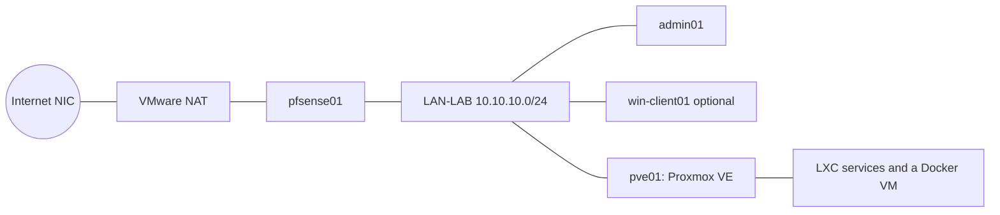

# Welcome

Welcome, now let's build the LAB infrastructure we are going to need to complete this class. By the end of
guide 18 you will have a small business's IT estate running on your own workstation: a firewall, central
identity with single sign-on, file and mail services, applications, monitoring, backup, and wireless
authentication. You build it yourself, from code, so it is repeatable: a wiped PC costs an afternoon to
rebuild, not a term.

## What you will build

See [docs/design/lab-build-design.md](../design/lab-build-design.md) for the full design and the reasons
behind it.

## Why

Other classes teach you to build one server at a time. This one is where it comes together: you build one
platform, measure how weak it is, harden it, measure again, and explain the difference. None of that works
without a real platform underneath it, which is what these 18 guides build.

## How the guides work

Each guide covers **what you will build**, **why**, the **steps**, **how to check it worked**, and **if it
goes wrong**. Guides 01 to 04 are done by hand, at the console or in a GUI. From guide 05 on, nearly
everything is one `make` command, because the computer should do the repetitive part so you can think about
the interesting part.

## Steps

There is nothing to build in this guide. Read it, then start with
[01-prepare-the-workstation.md](01-prepare-the-workstation.md).

## Check it worked

You understand the shape of what you are about to build and why, and you know where the full design lives
if you want more detail.

## If it goes wrong

If any guide's steps do not match what you see on screen, that is useful information, not just an
inconvenience: note it and see `CONTRIBUTING.md`. Every component in this repo is labelled in
[STATUS.md](STATUS.md) until someone has verified it on a real build, and your report is how it gets there.

## Rules

- **Your own lab only.** Nothing here is built to attack anyone else's systems, and nothing in the security
  weeks later in the course will be either.
- **Time:** building the whole lab the first time takes a few hours across several sessions. Guide 03 has a
  time estimate for the trickiest part (nested virtualisation).
- **It is meant to be rebuilt.** Workstations here are shared and may be wiped at any time. The repo is the
  lab; a VM is disposable.

Start with [01-prepare-the-workstation.md](01-prepare-the-workstation.md).
