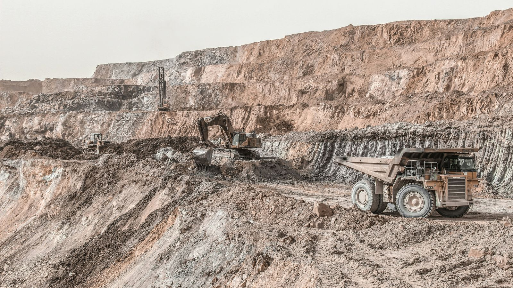
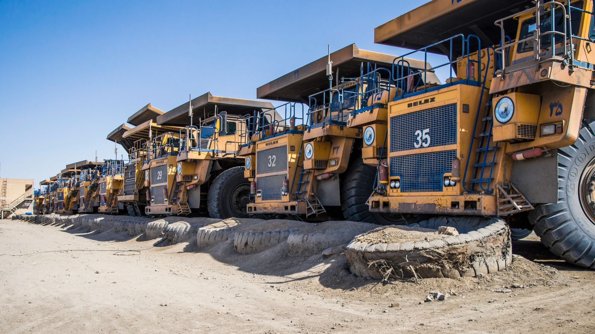
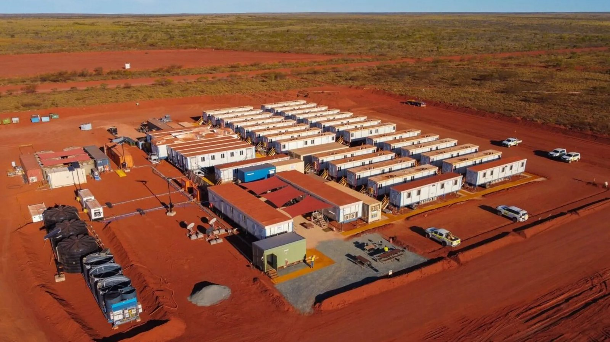
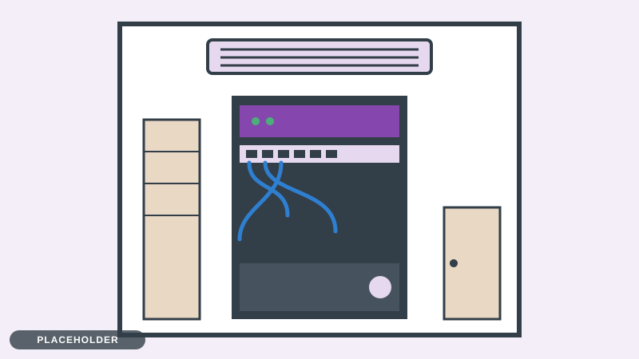

# Boab Ridge Mining Services: company profile

_Keep the site running._

## At a glance

Boab Ridge Mining Services is a Perth company of about 60 staff that keeps mines working. When a crusher stops, a haul truck needs servicing or a plant shuts down for a week of repairs, Boab Ridge sends the fitters, welders and planners. It works for mid-sized and large mine operators in the Pilbara and the Goldfields, from a head office in Perth and a remote site office in the Pilbara.

|             |                                                                                                          |
| ----------- | -------------------------------------------------------------------------------------------------------- |
| **Founded** | 2011, in Welshpool, Perth                                                                                |
| **People**  | About 60 staff (45 in Perth, 15 at the site office) and about 25 rostered contractors who fly in and out |
| **Revenue** | About A$14.2 million (financial year 2026)                                                               |
| **Clients** | Three contracts, the largest with a mine operator that is part of an international group                 |
| **Hours**   | Perth: 7am to 5pm on weekdays. Site: 24 hours a day                                                      |

*An open-cut mine of the kind Boab Ridge works on. Credit: Roshan (2021).*

## Our story

Boab Ridge started in 2011 as a two-person fitting and welding business in Welshpool. The founders did one thing well: they turned up, fixed the machine and went home with the job recorded properly. Word spread among Pilbara maintenance supervisors.

- **2011:** two fitters, one workshop.
- **2015:** the first long-term contract with a Pilbara mine operator.
- **2019:** a remote site office opens in the Pilbara, and the company grows to about 40 staff.
- **2022:** a place on the panel of a large mine operator that is part of an international group.
- **2026:** about 60 staff and three client contracts.

## What we do

*Heavy haul trucks wait their turn for servicing. Credit: Roshan (2022).*

- **Fabrication:** steel and equipment repairs made to order.
- **Fleet servicing:** scheduled servicing of heavy equipment, with every job recorded.
- **Shutdown crews:** teams that take over a plant during a planned shutdown and hand it back on time.

Each of these is a job: it is quoted, rostered, carried out, recorded and invoiced. The job record is how the company gets paid, so a lost or late record costs money.

## Two places, one company

|                  | Perth head office                                                                                 | Remote site office                                                              |
| ---------------- | ------------------------------------------------------------------------------------------------- | ------------------------------------------------------------------------------- |
| **People**       | About 45: management, finance and payroll, HR, planning and engineering, and a two-person IT team | About 15, plus rostered contractors                                             |
| **Hours**        | 7am to 5pm on weekdays                                                                            | 24 hours, two 12-hour shifts, handover at 6am and 6pm                           |
| **What happens** | Quotes, rosters, payroll, invoices and contracts                                                  | Job cards, timesheets, safety records and parts                                 |
| **Computers**    | 40 Windows laptops and desktops, 5 Linux engineering workstations                                 | 12 Windows PCs, 6 shared rugged tablets, 3 printers                             |
| **Connection**   | The office network and the internet                                                               | A satellite link to Perth: slow, with a long delay, and it drops in bad weather |

The site works around the clock and cannot wait for Perth to wake up. Power comes from a generator that fails now and then.

*Placeholder illustration: the remote site office.*

## Who is who

The full organisation chart, with all 60 staff, is in [org-chart.md](org-chart.md). The directory that the lab imports into Samba AD is `lab/data/users.csv`: names, email addresses, titles, locations, business units, employee types and managers.

## Key people

- **Margaret Osei, general manager.** Decides what the company spends and which risks it accepts.
- **Dana Whitlock, operations manager.** Runs the quotes, rosters, crews and parts, and keeps the client happy. She looks at the job-tracking system every morning and does not want surprises.
- **Priya Raman, payroll officer.** Runs the fortnightly pay run and looks after employee records.
- **Tom Nguyen, site supervisor.** Runs the day shift at the remote site and keeps it working through storms and shift changes.
- **Ravi Kapoor and Erin Walsh, the IT team.** Two people look after every computer, the server and the network at both places. This is the team you work with.
- **Henrik Larsen, the client's group IT contact.** He works in the client's European head office. He is not Boab Ridge staff, but his rules apply to Boab Ridge.

## The client behind the client

Boab Ridge's biggest contract is with a large mine operator that belongs to an international group. The group's head office in Europe or the USA decides the network standards, the security requirements for contractors, and who approves changes to anything that touches its systems. Perth is many hours ahead, so calls and approvals often happen at awkward times.

Contractors have to meet the client's rules:

- multi-factor sign-in for remote access and for administrators;
- logs kept for a set time and protected from editing;
- telling the client about a security incident within 24 hours;
- showing how the contractor compares with the ASD Essentials.

> **Careful:** These are rules to meet, not options to weigh. If a design does not meet them, the connection to the client's systems may not be allowed.

*Placeholder illustration: the comms cupboard in the Perth head office.*

## What Boab Ridge runs today

- A mix of Windows and Linux computers.
- One old server in the Perth comms cupboard that does too much: file shares, email, the job-tracking system and the public website.
- A job-tracking system for jobs, timesheets, parts and invoices.
- Payroll and roster records, and a directory of staff accounts.
- Backups, in theory.

## The money

These are invented figures, in the style of a small private company's published summary.

|                                  |                                                                    |
| -------------------------------- | ------------------------------------------------------------------ |
| **Revenue, financial year 2026** | About A$14.2 million                                               |
| **Growth**                       | About 9% a year over the last three years                          |
| **Contracts**                    | Three; the largest is about 60% of revenue                         |
| **Pay run**                      | Fortnightly: payroll closes Tuesday noon, payments go out Thursday |

## What has gone wrong

Three things have shaped how the company thinks about security.

1. **A fake email, last year.** A message asked payroll to change an employee's bank details. The payroll officer spotted it and nothing was lost, but it showed how close a mistake can be.
2. **A missing record, last month.** A job record could not be found, and an invoice dispute with the client took a week to settle.
3. **The link that drops.** When the satellite link fails, the site writes job cards on paper and types them in later, and some are lost.

## What matters most, and what does not

**Priorities**

- Crews rostered and paid correctly.
- Jobs recorded and invoiced on time.
- Safety records kept.
- The client's contract kept.
- The site working when the link to Perth is down.

**Not priorities**

- A polished public website. It needs to work and be safe, not to impress.
- The newest tools for their own sake. The company wants things it can keep running with two IT staff.
- Moving everything to the cloud or keeping everything on site. Nobody has decided, and the company will follow good reasons.

> **Careful:** "Not a priority" does not mean "ignore". It means do not spend the limited time and money here before the priorities are covered.

---

_Boab Ridge Mining Services is a fictional company for teaching. Any resemblance to a real business or person is accidental._
