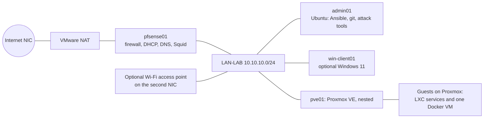
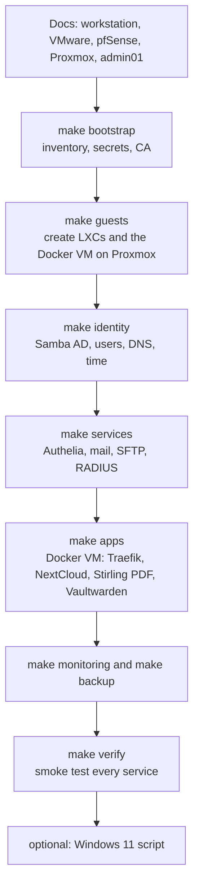

# Lab build design: a business in a box

Status: **draft, 2026-10-21.** Design for the full lab build that learners complete before the security work in [how-it-works.md](../how-it-works.md). The security loop (attack, harden, attack again) needs a whole platform to test; this document defines that platform and the docs, scripts and automation that build it.

## Intent

Welcome, now let's build the LAB infrastructure we are going to need to complete this class. A learner starts with a blank workstation and ends with a small business's IT estate running on it: firewall, central identity with single sign-on, file and mail services, applications, monitoring, backup, wireless authentication, and a client or two. They build it from this repo with documents, scripts and Ansible, so it is repeatable, and so a wiped PC costs an afternoon, not a term.

Why: security only makes sense against a real platform (see the security loop). The learner should also see that every service they will later harden is one they built and understand.

## Goals, non-goals, anti-goals

Goals

- Every service the course assesses is present and works: directory, DNS, DHCP, time, web and reverse proxy, filtering proxy, file transfer, mail, file shares, SSO, WPA-Enterprise authentication, monitoring and logging, backup and restore.
- Built by documents plus automation: after the hardware-level steps, one command per layer.
- Light enough for one learner on one 32 GB workstation.
- A learner can reach a verified, working lab with one command (`make verify`).
- Open source throughout; configuration that is understood, not magic.

Non-goals

- High availability, multi-site, federation, or enterprise scale.
- Production hardening. The lab is deliberately functional but not secure; hardening is the learner's later job.
- Supporting every hypervisor. One reference platform, documented well.

Anti-goals (a failure even if it technically works)

- A learner copies commands without knowing what they do. Each build step says what and why, and automation is read before it is run.
- Secrets in the repo or in terminals. Service secrets are generated and kept out of git.
- A lab that only the author can rebuild.

## The reference platform

One shared Windows 11 workstation per learner: about 10 cores, 32 GB RAM, 512 GB to 1 TB NVMe, two NICs (one lab, one internet), VMware Workstation. Used by one person at a time.



### VMware guests

| Guest          | Role                                                                                | RAM           | Notes                                                                          |
| -------------- | ----------------------------------------------------------------------------------- | ------------- | ------------------------------------------------------------------------------ |
| `pfsense01`    | Firewall, DHCP, DNS forwarder, NAT, Squid filtering proxy                           | 1.5 GB        | Not Ansible-managed; config template imported, Squid set from documented steps |
| `pve01`        | Proxmox VE (nested KVM and LXC)                                                     | 16 GB, 8 vCPU | Nested virtualisation on. Guests inside can over-commit                        |
| `admin01`      | Ubuntu Desktop: Ansible control node, git, attack and audit tools, the `sslab` tool | 3 GB          | Where the learner works                                                        |
| `win-client01` | **Optional** Windows 11 for the Windows layer of the security work                  | 4 GB          | Debloated by script; domain joined                                             |

With the Windows host (about 4 GB) the total is about 28.5 GB with Windows 11 running, and less without it. One user, VMware Tools everywhere, and RAM over-commit inside Proxmox keep it from swapping badly. The memory figures are estimates until measured on a real workstation.

### Proxmox guests

All on `lab.internal` (realm `LAB.INTERNAL`, NetBIOS `LAB`), network `10.10.10.0/24`, gateway `pfsense01` at `10.10.10.1`.

| Guest        | Type            | Role                                                                             | RAM    | Address |
| ------------ | --------------- | -------------------------------------------------------------------------------- | ------ | ------- |
| `samba-dc01` | LXC             | Samba AD: identity, Kerberos, LDAP, internal DNS, NTP                            | 1 GB   | .21     |
| `auth01`     | LXC             | Authelia: SSO for the apps (OIDC where supported, forward auth otherwise)        | 0.5 GB | .22     |
| `radius01`   | LXC             | FreeRADIUS, WPA-Enterprise (PEAP-MSCHAPv2) against Samba                         | 0.5 GB | .23     |
| `mon01`      | LXC             | Prometheus, Grafana, Loki, Alertmanager; log collection                          | 2 GB   | .24     |
| `mail01`     | LXC             | Postfix, Dovecot, OpenDKIM, OpenDMARC, LDAP-backed mailboxes                     | 1 GB   | .25     |
| `files01`    | LXC             | Domain member file server: OpenSSH SFTP (chrooted accounts) and Samba SMB shares | 0.5 GB | .26     |
| `pbs01`      | LXC             | Proxmox Backup Server for guest backups and restore tests                        | 1 GB   | .27     |
| `docker01`   | VM (cloud-init) | Docker, Traefik, NextCloud, Stirling PDF, Vaultwarden                            | 5 GB   | .30     |

Total about 11.5 GB of the 14 GB inside Proxmox, before over-commit.

Addresses: pfSense `.1`, Proxmox host `.5`, `admin01` `.10`, `win-client01` `.11`, DHCP pool `.100` to `.199`.

## How it fits together

- **Identity.** Samba AD is the single source of identity. Every other service authenticates against it (LDAP, Kerberos or RADIUS). Users and groups come from a CSV the learner can read and change (`lab/data/users.csv`).
- **SSO.** Traefik on `docker01` fronts the apps. NextCloud and any other OIDC-capable app use Authelia as an OIDC provider; apps without good OIDC (Stirling PDF, and the Vaultwarden web vault) sit behind Authelia forward auth. Authelia reads users from Samba over LDAP and enforces a second factor for the admin group.
- **Certificates.** An internal two-tier CA (adapted from `lab-small-business`) issues certificates; `admin01` and `win-client01` trust it.
- **Wireless.** `radius01` authenticates PEAP-MSCHAPv2 users against Samba. Two ways to exercise it: a real access point on the second NIC (hardware the lab already has), or `eapol_test` from `admin01`, which performs the same EAP exchange and is the default.
- **Observability.** Every guest runs a metrics exporter and ships logs; `mon01` shows dashboards, alert rules and a Loki log view. This is also what the learner checks during the attack, to see whether anything noticed.
- **Backup.** `pbs01` backs up the guests; a scripted restore test proves it.
- **Web and proxy.** Squid on pfSense is the filtering forward proxy; Traefik is the reverse proxy.

## Where the configuration comes from (honest)

`lab-small-business` is VM-based, uses Authentik for SSO, and has no LXC, Proxmox, RADIUS, SFTP or monitoring. So:

| Layer                                                                                                                 | Source                                                                                            |
| --------------------------------------------------------------------------------------------------------------------- | ------------------------------------------------------------------------------------------------- |
| Samba AD provisioning, users and groups, backup script                                                                | **Adapt** `samba/scripts` (rewritten as an Ansible role for an LXC)                               |
| Two-tier internal CA, trust distribution                                                                              | **Adapt** `pki/` and the `pki_trust` role                                                         |
| Mail (Postfix, Dovecot, DKIM, DMARC, SPF notes)                                                                       | **Adapt** the mail configuration files from `docker/mail`; run natively in an LXC                 |
| Traefik, NextCloud, Stirling PDF stacks                                                                               | **Adapt** `docker/reverse-proxy`, `nextcloud`, `stirling-pdf`                                     |
| Baseline role (chrony, firewall, SSH, updates)                                                                        | **Adapt** the `common` role, but **without the hardening**: the lab starts functional, not secure |
| Authelia (SSO), FreeRADIUS, Vaultwarden                                                                               | **New** (the source uses Authentik; the lab uses Authelia because it is lighter)                  |
| Proxmox guest creation, files01 (SFTP, shares), monitoring, Proxmox Backup, pfSense template, Windows debloat, verify | **New**                                                                                           |

New work is the bigger half. Every new component starts as "unverified" in the status table.

## Build order and the automation shape

Hardware-level steps are documents (creating VMs, networks, installing pfSense and Proxmox). Everything after that is Ansible run from `admin01`, one playbook per layer, plus `make` targets as the single front door.



Proxmox access: `admin01` reaches `pve01` over **SSH with a key installed in build guide 03**, and Ansible runs `pct`, `qm` and `pveam` there (no API token, no `proxmoxer`). LXC templates come from `pveam`, and the Ubuntu cloud image is downloaded on `pve01`, both through pfSense NAT. Storage: `local` for templates and images, `local-lvm` (or `local` if absent) for guests. Guest creation is idempotent: it checks whether the guest exists before creating it.

Single source of truth: the Ansible inventory and `group_vars/all.yml` (domain, network, host names, addresses, RAM). Scripts and docs read the same values; nothing is typed twice.

Secrets: `scripts/gen-secrets.sh` writes random service passwords and the CA keys as plain files into a gitignored `lab/secrets/` directory, never prints them, and does **not** regenerate anything that already exists, so `make bootstrap` is safe to re-run. Because the PC can be wiped, `scripts/backup-secrets.sh` writes an `age`-passphrase-encrypted archive to a path outside the repo (for example the learner's USB drive); restoring it puts the same CA and secrets back. Human accounts in the CSV get a documented initial password from a short list; that is a deliberate "default" for the security loop and is called out in the instructor guide.

## Repository layout (new, under the existing repo)

```text
lab/
  Makefile                 the front door: bootstrap, guests, identity, services, apps, monitoring, backup, verify
  inventory/hosts.yml, group_vars/all.yml
  ansible/playbooks/       one per layer; roles/ for each service
  data/users.csv, groups
  pfsense/                 config.xml template, Squid notes, render script
  proxmox/                 guest definitions and helper scripts
  docker/                  compose stacks (traefik, nextcloud, stirling-pdf, vaultwarden)
  windows/                 debloat and domain-join scripts
  verify/                  smoke tests per service
docs/build/                numbered build guides, starting at 00-welcome.md
docs/instructor/           manager conversation guide and weak defaults
```

## The build guides

Numbered, in the order a learner works, in a friendly second-person voice, each with what you will build, why, the steps, how to check, and what to do when it goes wrong.

`00 Welcome` · `01 Prepare the workstation` · `02 pfSense` · `03 Proxmox` · `04 admin01` · `05 The repo, inventory and secrets` · `06 Create the guests` · `07 Identity: Samba AD` · `08 DNS, DHCP and time` · `09 Squid` · `10 Docker VM and apps` · `11 Single sign-on` · `12 Mail` · `13 File transfer and shares` · `14 Wi-Fi: RADIUS` · `15 Monitoring and logs` · `16 Backup and restore` · `17 Windows 11 (optional)` · `18 Verify your lab`. A table maps them to the course weeks.

## Decisions the build must honour

- **Authelia:** a native package in the `auth01` LXC. Users and groups come straight from Samba over LDAP. Second factor is TOTP, required for the admin group. Storage is SQLite with in-memory sessions (lab scale; no Redis or Postgres). NextCloud authenticates by OIDC against Authelia; Stirling PDF and the Vaultwarden web vault sit behind Authelia forward auth in Traefik.
- **Samba AD DC:** a **privileged** LXC (`samba_dc_privileged: true` in `group_vars`), because ACL, xattr and idmap support is dependable there. The lab network is isolated, which is the stated trade-off. The fallback if it still fails in the first real build is a small VM, documented but not coded.
- **`radius01`:** an unprivileged LXC that joins the domain as a member with `net ads join` and runs `winbindd`, so FreeRADIUS can use `ntlm_auth` for PEAP-MSCHAPv2.
- **Squid on pfSense:** an explicit forward proxy on port 3128 for the LAN, no SSL interception, from the pfSense CE package. The `config.xml` template covers interfaces, DHCP (DNS handed out as `.21` first, `.1` second), the DNS forwarder to `samba-dc01` for `lab.internal`, and NAT. Servers use static addresses set inside the guests, not DHCP.
- **`make verify`:** each check prints PASS, FAIL or SKIP. A missing optional component (Windows 11, the access point) is SKIP and does not fail the run; any FAIL exits non-zero.

## The lab must be weak in the ways the security loop expects

The security loop (`docs/attack-set.md`) needs something to find. The build is functional but not secure, and the Ansible roles must **not** harden. Concretely the build must leave:

| Attack           | Target                           | What the build leaves in place                                                                                         |
| ---------------- | -------------------------------- | ---------------------------------------------------------------------------------------------------------------------- |
| `enum-services`  | all guests                       | Only services the design needs, but with default banners and open management ports                                     |
| `ssh-weak-creds` | `files01`, `docker01`, `admin01` | SSH password login on; AD user accounts created from the CSV with initial passwords drawn from a short documented list |
| `web-basics`     | `docker01` (Traefik, port 80)    | Default headers: no HSTS, CSP or frame protection; server banner visible                                               |
| `mail-basics`    | `mail01`                         | Postfix defaults: `VRFY` on, relay allowed for the local subnet                                                        |
| `anon-directory` | `files01`                        | A public "notices" share with guest access, as many how-tos create                                                     |

These are recorded in `docs/instructor-weak-defaults.md`, and `lab/verify/` checks they are present, so a learner who hardens early notices before the baseline.

## Windows 11 (optional)

A PowerShell script: removes or disables telemetry and diagnostics (DiagTrack, `dmwappushservice`, feedback, advertising ID), removes Copilot and Recall components and sets the policies that stop them returning, removes consumer apps and OneDrive sync, disables Widgets and consumer features, then joins the domain and trusts the lab CA. Idempotent and logged so a learner can read what changed.

## The security report and the manager conversation

Builds on the existing security loop. After the first (default) attack and audit, learners produce a short **analysis**: for the main findings, what an attacker could do, and what that means for the business. The lecturer plays the **manager**. The conversation happens after the first results and again after the second. The rule for the learner is business language only: money, customers, trust, downtime and legal duties, with no technical terms. Deliverables:

- A one-page plain-language **briefing note** the learner writes before the meeting (template provided).
- The conversation itself, guided by an instructor guide: scenario cards, the manager's questions, a rubric focused on whether a non-technical person would make a good decision from what they heard.
- A tool addition: `sslab` can print an empty **impact table** from a comparison (finding, what could happen, business consequence) for the learner to fill in, in their own words.

## Constraints

- Open source, lightweight first. Python 3.11+ standard library for tooling; Ansible for automation.
- Configuration is adapted from `lab-small-business` only where it really exists (see the next section). The rest is new work and is labelled as such.
- Generic wording: no institution names, unit codes or brand colours. LF line endings. Docs in Markdown and Mermaid, with the reasons recorded.
- No secrets in git; no secrets printed.

## Honest status and verification

The author cannot run Proxmox, pfSense or Windows in the build environment. So:

- Everything is validated statically here: YAML and Ansible syntax and lint, `docker compose config`, template rendering, shell lint, and Python tests for the tooling.
- Every component is labelled **unverified** in a status table until a person has built it on a real lab workstation and ticked it off against `docs/build/18-verify.md`. The first full build is the validation; expect fixes.
- Known risks, to settle in that first build: Samba AD in an unprivileged LXC, Proxmox Backup Server in an LXC (not an officially supported layout; fallback is `vzdump` to local storage), PEAP-MSCHAPv2 through winbind, and the memory figures.

## Testing here versus on the lab

Validation done in the build environment: Ansible syntax and lint, YAML lint, `docker compose config`, `xmllint` on the pfSense template, `shellcheck`, Jinja template rendering, and Python tests (for `sslab` and the secrets and render helpers). PowerShell is checked by a documented review only (no PowerShell here).

## Left to the builder

- Exact package versions, Debian or Ubuntu template choice per LXC, Authelia configuration schema for the pinned version.
- The Windows debloat checklist details and Windows Server evaluation guest (not in the default build).
- Dashboard and alert rule content.
- Chapter wording within the voice above.

## Decisions made (designer's calls, open to change)

1. Domain `lab.internal` and `10.10.10.0/24`, to match `lab-small-business` so its configuration lifts cleanly.
2. Debian 12 LXC templates for service containers; Ubuntu 24.04 cloud image for the Docker VM and `admin01`.
3. `eapol_test` is the default way to demonstrate WPA-Enterprise; a hardware access point is an optional extra.
4. Vaultwarden is behind forward auth for its web vault only; its apps use their own master password.
5. Greenbone (a heavy vulnerability scanner) is not in the default build; nmap, Lynis and the attack set cover the course.
6. Squid is configured on pfSense from documented steps rather than imported XML, because package configuration in `config.xml` is brittle across versions.

## Open items

- Which Wi-Fi hardware the lab has, if the optional access point path is used.
- Where the Windows 11 evaluation media and licensing come from.
- Whether `pbs01` stays in an LXC after the first real build.
