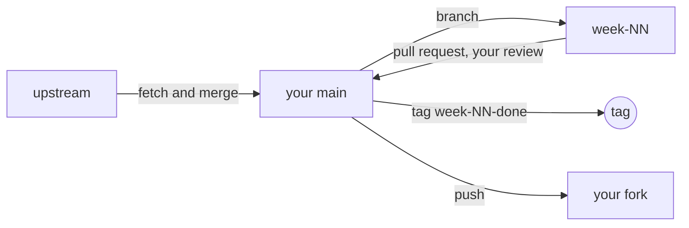

# Git workflow for the lab

Infrastructure is code, so it is managed like code.

1. **Fork** the upstream repo (private), clone it on `admin01`, and add `upstream` as a second remote:
   `git remote add upstream <upstream-url>`.
2. **Branch per week** (`week-04`), commit as you go, open a pull request into your own `main`, and
   merge it after your own review. A partner or your instructor can review at assessment checkpoints.
3. **Sync weekly:** `git fetch upstream`, read the change log, then merge `upstream/main` into `main`
   before starting the next week.
4. **Tag the finished week** (`week-04-done`). A wiped PC is rebuilt from the tags.
5. **Secrets** live in a gitignored `.env` and an Ansible vault, never in the fork.

## A merge conflict is expected once

If you edited a file under `scaffold/`, `weeks/` or `docs/`, merging upstream may conflict. That is the
exercise: why you branch, how a conflict looks, and how to resolve it. Keep your own work in `build/`
and `portfolio/` to avoid it.
