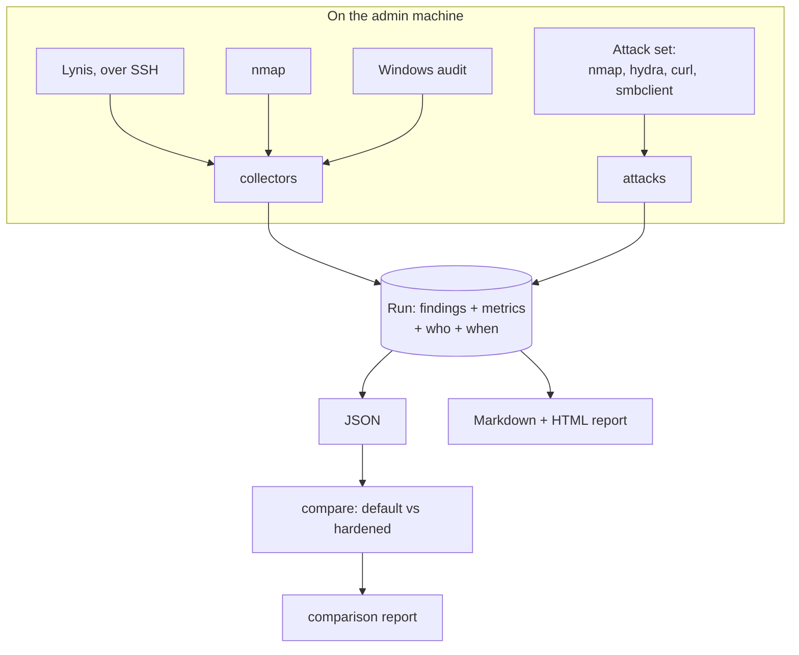

# How it works

## The idea

Security is a property of a whole platform, so the evidence is gathered across the whole platform, twice:
once as built (**default**), once after hardening (**hardened**). The same tools produce both, so the
difference is attributable to what the learner changed.

## The data model

Every tool is reduced to one record (`scaffold/sslab/findings.py`):

- **Finding**: stable `id`, a `layer` (network, host, service, identity), `title`, `severity`, `detail`.
- **Run**: label (`default` or `hardened`), tool, host, student, fork, lab range, UTC start time, findings,
  `not_run`, and `metrics` (scores such as the Lynis hardening index).

Stable ids are what let the comparison match a finding in the "before" run with the same finding "after".

## Design decisions and why

| Decision | Reason |
| -------- | ------ |
| Python standard library only | Learners run it on a lab machine they can wipe at any time; nothing to install or break |
| Tools are *driven*, not reimplemented | Learners should meet the real tools; we only parse their output |
| A tool that fails is `not_run`, never "clean" | An attack that did not run is not an attack that failed. The comparison marks it *not compared* instead of *closed* |
| Reports are generated, timestamped and carry the student and fork | Each learner's evidence is their own run; a copied report visibly belongs to someone else, and `compare` refuses runs from different students |
| Scope file first, targets checked before any packet | Teaches authorisation as part of the craft, and stops typos reaching other networks |
| Strict scope parsing | `10.10.0.5/24` is rejected rather than silently widened to a whole network |
| Untrusted output is neutralised in reports | Banners and tool output come from machines under test; a hostile banner must not forge table rows or inject markup |
| The score never decides the outcome | A learner who leaves a finding open and explains the trade-off has learned more than one who chases 100 |
| An empty *before* run is rejected; an empty *after* run is allowed with a caution | A fully hardened service can legitimately find nothing; rejecting it would punish success |

## Comparison states

| State | Meaning |
| ----- | ------- |
| closed | In the default run, gone after hardening |
| reduced | Still there, lower severity |
| unchanged | Still open: the interesting ones to explain |
| new | Appeared after hardening: something the hardening introduced |
| not compared | The tool did not run the second time; fix and rerun |

Gaps (unchanged, new) are listed before closed findings, so the first thing a learner reads is where the
onion still has a hole.
